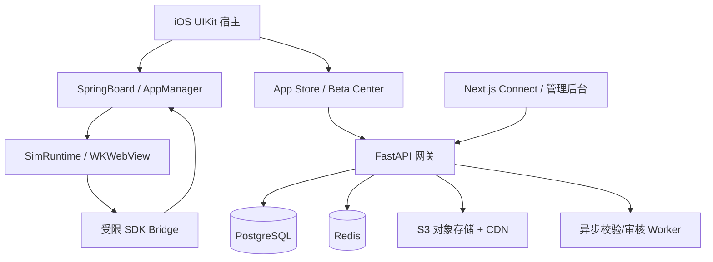

# iOS 6 Simulator — 完整技术开发文档 v1.0

> 文档类型：PRD + 系统架构 + API/SDK 规范 + 实施计划  
> 状态：设计基线（尚未开发）  
> 目标：构建 iOS 6 风格的现代 iPhone 宿主应用，以及独立的开发者 Connect、Beta 测试分发和应用商店生态。  
> **重要声明**：本项目的 Connect、TestFlight 和 App Store 均为自行建设的服务，不是苹果官方服务，不接入官方 App Store Connect 或 TestFlight；产品命名、图标及视觉资产须避免误导用户或侵犯商标与著作权。

---

## 1. 产品目标与边界

### 1.1 产品目标

开发者编写 HTML/CSS/JavaScript 应用，封装成 `.simapp`，通过 Connect 上传构建，邀请测试者在模拟器内的 Beta 测试中心安装、提交反馈，经平台审核后发布至模拟器 App Store。终端用户可搜索、下载、安装、打开、更新、卸载应用，并保留应用数据。

模拟器复刻 iOS 6 的锁屏、桌面、Dock、状态栏、文件夹、动画和基础系统应用。要求功能真实可用，而非截图式原型。

### 1.2 明确不做

- 不运行原生 `.ipa`、Mach-O、Swift 动态模块或第三方原生 iOS 应用。
- 不修改 iPhone 的真正 SpringBoard、系统权限、主屏幕或内核。
- 不宣称与苹果官方 Connect、TestFlight、App Store 存在关联。
- 不通过动态下载的 JavaScript 获取不受控的原生能力；能否在苹果官方商店发布宿主需要独立合规评估。
- 第一版不支持第三方应用任意安装 npm 原生扩展或执行服务器命令。

### 1.3 交付物

1. `ios-host/`：可编译运行的 Swift/UIKit 宿主，内含系统 UI、商店、测试中心、运行时。
2. `developer-web/`：开发者 Connect 与管理员审核后台。
3. `backend/`：API、权限、版本发布、审核、分发与任务处理。
4. `sdk/`：TypeScript SDK、UI 组件、CLI、示例应用。
5. `infra/`：数据库迁移、Docker Compose、CI/CD、部署配置。
6. 文档、自动化测试、演示应用、GitHub Actions 构建配置。

## 2. 用户角色与核心用例

| 角色 | 权限 | 核心用例 |
|---|---|---|
| 游客 | 浏览公开应用 | 搜索、查看详情 |
| 普通用户 | 安装、运行、评价 | 本地安装、更新、卸载、反馈 |
| 测试者 | 安装获邀 Beta | 邀请码兑换、反馈、崩溃日志授权上传 |
| 开发者 | 管理自己的应用 | 创建应用、上传构建、发布说明、查看统计 |
| 团队管理员 | 团队与成员管理 | 邀请成员、分配角色 |
| 审核员 | 审核队列 | 审核、拒绝、下架、申诉处理 |
| 平台管理员 | 平台运营 | 账号处置、分类、推荐、审计 |

用户完整路径：注册 → 下载应用 → 点击桌面图标 → 本地运行 → 关闭后再次启动 → 数据仍存在。

开发者完整路径：创建 App → 上传包 → 静态校验 → Beta 分发 → 修复问题 → 送审 → 审核通过 → 发布 → 用户安装更新。

## 3. 总体架构



建议先采用模块化单体 + 异步 Worker，不提前微服务化。所有客户端与服务端通过带版本号的 JSON API 通信。

### 3.1 技术选型

- iOS：Swift 6、UIKit、WebKit、Core Animation、URLSession、Keychain、SQLite（本地元数据）。
- 开发者站：Next.js、TypeScript、React、Tailwind CSS。
- 后端：Python 3.12、FastAPI、SQLAlchemy 2、Alembic、Pydantic。
- 数据：PostgreSQL、Redis；对象存储 S3 兼容协议；CDN。
- 后台任务：Celery 或 RQ（二选一，MVP 采用 RQ）。
- 监控：OpenTelemetry、结构化日志、错误聚合。
- CI：GitHub Actions；iOS 构建使用 macOS Runner；后端使用 Linux Runner。

## 4. iOS 6 模拟器宿主

### 4.1 界面组件

| 模块 | 功能要求 | 优先级 |
|---|---|---|
| LockScreen | 时钟、日期、滑动解锁、壁纸 | P0 |
| SpringBoard | 分页、Dock、长按编辑、移动图标 | P0 |
| Folder | 文件夹创建、打开、重命名 | P1 |
| StatusBar | 时间、网络、电池的宿主映射/模拟 | P0 |
| AppSwitcher | 最近使用、恢复与退出 | P1 |
| App Store | 分类、搜索、详情、安装、更新 | P0 |
| Beta Center | 邀请、构建列表、安装、反馈 | P0 |
| Settings | 账户、存储、权限、主题、模拟器信息 | P0 |
| Notes/Calculator | 可操作的基础应用 | P1 |
| Camera/Photos | 授权后桥接系统能力（单独评估） | P2 |

视觉还原需要参考 iOS 6 真机截图和合法获取的图标、壁纸、声音与纹理。素材许可应逐项登记；无法获得授权时采用原创的拟物化替代素材。

### 4.2 宿主数据与生命周期

`InstalledApp`：`appId`、`buildId`、`version`、`bundlePath`、`iconPath`、`installedAt`、`channel`、`permissions`。  
`DesktopLayout`：页面、图标顺序、文件夹、Dock 位置。  
`AppSession`：应用标识、前后台状态、上次激活时间、WebView 实例。  
状态：`notInstalled → downloading → verifying → installed → launching → foreground → background → terminated`；异常转移应可恢复。

下载到临时目录，先验证，再原子化移动到安装目录。更新时保留数据目录；失败回滚旧版本。每个 appId 仅允许一个活动正式构建，Beta 渠道另行标记。

## 5. `.simapp` 应用包规范

### 5.1 包结构

```text
PixelNotes.simapp (ZIP)
├── manifest.json
├── index.html
├── js/app.js
├── css/style.css
└── assets/icon.png
```

### 5.2 清单示例

```json
{
  "schemaVersion": 1,
  "id": "com.example.pixelnotes",
  "name": "Pixel Notes",
  "version": "1.2.0",
  "runtime": "web",
  "entry": "index.html",
  "minSimulatorVersion": "1.0.0",
  "permissions": ["storage"],
  "orientation": "portrait",
  "icon": "assets/icon.png"
}
```

### 5.3 安装包约束

- 版本采用 SemVer；`id` 全局唯一且一经发布不可变更。
- 入口文件与图标必须存在；禁止绝对路径、`../`、符号链接逃逸、设备文件。
- 限制压缩包体积、解压后体积、文件数量、压缩比、单文件大小；阈值配置化。
- 服务端生成 `buildId`、SHA-256 与签名元数据；客户端使用内置可信公钥验证签名及文件摘要。
- 上传包先隔离存储，验证通过后才能分发；上传与审核后发布的是不可变构建。
- 包内不允许原生可执行代码；远程脚本与外部资源按运行时安全策略限制。

## 6. SimRuntime 与 SDK

### 6.1 运行模型

采用受控的 WKWebView 加载安装包。每个应用使用独立逻辑身份、存储命名空间和受限桥接权限。**WKWebView 本身不保证不同应用完全安全隔离**：需设计来源校验、资源访问控制、进程/数据存储策略、消息协议与异常处置。

自定义资源加载可考虑 `WKURLSchemeHandler`，但要验证具体 scheme 对安全来源、Cookie、存储及 CSP 的影响。若无法保证应用级来源隔离，不得让不同应用共享可访问的 Web 存储；优先通过宿主提供的按 appId 隔离存储 API 管理数据。

### 6.2 桥接消息协议

```json
{
  "protocolVersion": 1,
  "requestId": "uuid",
  "method": "storage.set",
  "params": { "key": "note", "value": "hello" }
}
```

响应：`{ "requestId": "uuid", "ok": true, "result": null }`；失败时返回 `{ "requestId": "uuid", "ok": false, "error": { "code": "PERMISSION_DENIED", "message": "..." } }`。

宿主不信任客户端传入的 `appId`：应用身份必须由当前 WebView 会话绑定。每次桥接校验方法白名单、来源、参数 schema、授权、频率、载荷大小。禁止暴露任意文件路径、任意 Objective-C Selector 或任意原生方法调用。

### 6.3 SDK v1

```ts
interface SimulatorSDK {
  storage: {
    get(key: string): Promise<string | null>;
    set(key: string, value: string): Promise<void>;
    remove(key: string): Promise<void>;
  };
  app: {
    getInfo(): Promise<{ id: string; version: string }>;
    close(): Promise<void>;
  };
  ui: {
    setTitle(title: string): Promise<void>;
    alert(message: string): Promise<void>;
  };
}
```

第一版只允许 `storage`、`app`、`ui` 等受控能力。通知、照片、摄像头、网络代理、剪贴板等需分别定义权限与安全边界，逐项上线。

### 6.4 生命周期事件

`simulator:launch`、`simulator:resume`、`simulator:pause`、`simulator:terminate`、`simulator:themechange`。后台暂停计时器不是强安全保证；资源消耗由宿主限制，内存压力下可销毁 WebView 并重建。

### 6.5 网络策略

默认禁止应用通过桥接请求任意内网或宿主 API。对 WebView 的直接网络访问制定明确策略并测试实际可执行性；无法可靠强制限制时应采用审核、权限提示、CSP 和最小化原生权限的组合防护，不宣称具备无法验证的网络沙箱。

## 7. 自建 App Store

### 7.1 主要页面

精品推荐、排行榜、分类、搜索、更新、应用详情、评价、已购/已安装（第一版仅免费应用）。详情展示开发者、版本、权限、截图、年龄分级、隐私说明和更新日志。

### 7.2 安装事务

1. 用户点击安装，客户端请求短时效安装票据。
2. 服务端校验应用状态、用户权限、地区/年龄规则与渠道。
3. 客户端从 CDN 下载固定 buildId 的包，支持断点续传。
4. 客户端验证 SHA-256、签名、manifest 与解压安全性。
5. 原子化安装并记录本地索引；更新保留用户数据。
6. 主屏幕刷新图标；点击后启动独立会话。
7. 安装失败必须可重试、可清理残留；服务端统计采用幂等事件。

卸载默认删除应用私有数据，必须明确提示；可在设置中提供保留数据的可选策略。

## 8. Connect 开发者平台

### 8.1 页面

登录注册、开发者团队、我的应用、创建应用、版本与构建、测试组、邀请管理、审核提交、发布管理、下载统计、反馈、错误报告、审计日志。

### 8.2 上传流水线

`draft → uploaded → validating → validated → beta_available → in_review → approved/rejected → published → deprecated/removed`。

状态不应全部混在同一个字段：构建校验状态、测试渠道状态、审核状态、生产发布状态分别存储，避免不可解释的组合。

上传通过预签名 URL 直传对象存储，服务端接收完成回调后执行解压校验、manifest 检查、哈希生成、恶意内容规则扫描与元数据解析。审核员确认后才允许公开分发。

### 8.3 权限

团队角色：Owner、Admin、Developer、Analyst。审核员和平台管理员使用独立管理域，所有审核与下架操作记录操作者、时间、原因与构建摘要。

## 9. 自建 Beta 测试分发（TestFlight 风格）

- 支持内部/外部测试组、邀请链接、一次性兑换码、邀请到期与撤销。
- 测试组绑定不可变 buildId，可配置测试人数与有效期。
- Beta 构建与正式构建区分渠道；可按策略允许共存或替换，但必须保留/迁移用户数据。
- 测试者提交文字、截图、设备型号、模拟器版本；诊断数据需要明确同意。
- JS 错误、未处理 Promise、应用启动失败与耗时可采集，需脱敏。
- 开发者选择已通过校验的构建提交正式审核，审核通过后显式发布。
- 邀请链接须使用随机高熵令牌，服务端仅保存令牌哈希，支持过期、撤销和频率限制。

## 10. 数据库设计

使用 UUID 主键；关键表：

| 表 | 关键字段 |
|---|---|
| users | id, email, password_hash/identity_provider, status, created_at |
| developer_teams | id, name, owner_id |
| team_members | team_id, user_id, role |
| apps | id, bundle_id, team_id, name, category, visibility, created_at |
| app_builds | id, app_id, version, artifact_key, sha256, validation_status, created_at |
| app_releases | id, app_id, build_id, channel, release_status, published_at |
| review_submissions | id, app_id, build_id, status, reviewer_id, reason |
| beta_groups | id, app_id, name, active_build_id |
| beta_invitations | id, group_id, token_hash, expires_at, redeemed_by |
| installations | id, user_id, app_id, build_id, installed_at |
| feedback | id, user_id, build_id, content, attachment_key |
| ratings | id, user_id, app_id, stars, review_text |
| audit_logs | id, actor_id, action, target_type, target_id, metadata, created_at |

必要索引：`apps(bundle_id)` 唯一；`app_builds(app_id, version)` 组合唯一（若允许同版本重建，则额外使用 build_number）；`app_releases(app_id, channel)` 按活跃状态建立约束；邀请码哈希唯一。重要关联使用外键与事务。

## 11. REST API v1

统一前缀 `/v1`，JWT/OIDC 登录，刷新令牌轮换，错误响应含 `code`、`message`、`requestId`。上传、提交审核、发布、兑换邀请码均使用幂等键。

```http
POST   /v1/auth/register
POST   /v1/auth/login
GET    /v1/me
POST   /v1/developer/apps
GET    /v1/developer/apps
POST   /v1/developer/apps/{appId}/builds/upload-url
POST   /v1/developer/apps/{appId}/builds/complete
GET    /v1/developer/apps/{appId}/builds
POST   /v1/developer/builds/{buildId}/submit-review
POST   /v1/developer/apps/{appId}/releases
POST   /v1/beta/groups
POST   /v1/beta/groups/{groupId}/invites
POST   /v1/beta/invites/redeem
GET    /v1/beta/my-builds
POST   /v1/beta/feedback
GET    /v1/store/featured
GET    /v1/store/search?q=notes
GET    /v1/store/apps/{appId}
POST   /v1/store/apps/{appId}/install-ticket
GET    /v1/store/updates
POST   /v1/admin/reviews/{submissionId}/approve
POST   /v1/admin/reviews/{submissionId}/reject
```

### 11.1 安装票据响应

```json
{
  "buildId": "uuid",
  "downloadUrl": "https://cdn.example.com/signed-package-url",
  "sha256": "64-character-lowercase-hex",
  "signature": "base64-ed25519-signature",
  "signatureKeyId": "release-key-2026-01",
  "expiresAt": "2026-12-01T12:00:00Z"
}
```

签名必须覆盖规范化的 buildId、appId、版本、SHA-256、权限清单等不可变字段，不能只签一个可替换的 URL。公钥轮换与撤销机制需纳入宿主更新策略。

## 12. 安全、隐私与内容治理

### 12.1 安全要求

- 所有上传文件视为不可信；隔离处理，严格资源配额，禁止任意解压写入。
- 强制 HTTPS、服务端鉴权、RBAC、速率限制、审计、请求大小限制。
- 应用桥接仅允许白名单能力；所有敏感能力需要宿主明确授权。
- 管理后台启用 MFA、最小权限、操作日志和二次确认。
- 使用服务端可信构建元数据和包签名防止 CDN/缓存篡改。
- 对 HTML/JS 应用采取 CSP、资源约束、内容审核和权限提示；这些不能替代真正的系统级沙箱。
- 防范 XSS、CSRF、SSRF、SQL 注入、越权访问、路径穿越、恶意压缩包、令牌重放。

### 12.2 平台治理

用户举报、开发者身份验证、应用隐私政策、年龄分级、内容审核、申诉、违规下架、恶意版本撤销、侵权投诉。商店页面必须清晰标注这是第三方虚拟应用生态，不是苹果官方服务。

### 12.3 合规风险

苹果 App Review 对宿主下载和运行第三方软件、小游戏及扩展功能有专门规则。当前架构**不保证**能通过苹果官方 App Store 审核；必须在开发早期开展政策评估与原型验证。若采用侧载方式，也仍受 iOS 沙箱和平台规则限制。不要以“WebView 可运行 JS”推导“任何动态应用商店均获准上架”。

## 13. Monorepo 目录规范

```text
ios6-simulator/
├── apps/
│   ├── ios-host/
│   │   ├── Simulator/
│   │   │   ├── Shell/{LockScreen,SpringBoard,AppSwitcher}/
│   │   │   ├── Store/
│   │   │   ├── BetaCenter/
│   │   │   ├── Runtime/{AppManager,WebRuntime,Bridge,Storage}/
│   │   │   ├── SystemApps/
│   │   │   └── Assets/
│   │   └── SimulatorTests/
│   ├── developer-web/
│   └── admin-web/
├── services/
│   ├── api/app/{auth,apps,builds,beta,store,reviews}/
│   └── worker/
├── packages/
│   ├── simulator-sdk/
│   ├── simulator-ui/
│   ├── simapp-cli/
│   └── shared-schemas/
├── examples/pixel-notes/
├── infra/{docker,db,github-actions}/
├── docs/
└── .github/workflows/
```

## 14. CI/CD 与部署

### 14.1 GitHub Actions

- `backend-ci.yml`：格式检查、类型检查、单元测试、数据库集成测试、镜像构建。
- `web-ci.yml`：lint、类型检查、构建、Playwright 测试。
- `ios-ci.yml`：macOS Runner、`xcodebuild` 编译、单元/UI 测试。
- `release.yml`：打 tag 后生成版本产物、迁移检查、分阶段部署。
- `security.yml`：依赖审计、密钥扫描、SBOM、上传包解析器模糊测试。

未签名 IPA 仅是构建产物，不代表能直接在普通 iPhone 上安装；真机安装仍取决于签名、分发方式与设备/系统限制。不要把无签名 IPA 描述为无需配置即可安装。

### 14.2 环境

`local`（Docker Compose）→ `staging`（独立数据库、对象存储）→ `production`。环境变量和密钥使用 CI Secrets/密钥管理器；禁止将密钥提交 Git。PostgreSQL 定期备份并演练恢复。

## 15. 测试策略

| 测试层 | 重点 |
|---|---|
| 单元测试 | manifest 校验、状态机、权限、SDK 协议 |
| 集成测试 | 上传、审核、邀请码、发布、安装票据 |
| iOS UI 测试 | 桌面布局、安装、启动、更新、卸载 |
| E2E | Connect → Beta → Review → Store → Runtime |
| 安全测试 | 路径穿越、ZIP 炸弹、跨应用存储、桥接伪造、越权 |
| 故障注入 | 断网、下载中断、签名失败、存储不足、升级回滚 |
| 兼容测试 | 目标 iOS 版本、不同屏幕尺寸、前后台切换 |

性能目标（初始目标，需实测调整）：冷启动宿主 3 秒内可交互；已安装轻量应用启动 2 秒内；安装失败不损坏旧版；更新后应用数据完整。网络下载时间不计入本地启动目标。

## 16. 实施里程碑

### M0：技术验证

- 验证 WKWebView 本地包加载、应用间数据隔离、桥接权限与生命周期。
- 验证目标 iOS 版本和分发路径；记录苹果审核风险与替代方案。
- 验证原版视觉素材许可或原创替代方案。

### M1：模拟器基础

完成锁屏、SpringBoard、Dock、状态栏、桌面持久化、设置、至少两个可用系统应用。

### M2：Runtime + SDK

完成 `.simapp` 解析、签名验证、安装/卸载/更新、桥接、私有存储、Pixel Notes 示例。

### M3：Connect + API

完成账号、团队、创建应用、上传构建、自动校验、审核管理与对象存储。

### M4：Beta Center

完成测试组、邀请、兑换、安装 Beta、反馈、错误报告与过期撤销。

### M5：App Store

完成公开商店、搜索、详情、安装、更新、评分、发布和下架。

### M6：安全与发布

端到端测试、性能优化、权限审计、运维告警、文档、CI/CD、安装产物。

每个里程碑完成后必须提供可运行代码、测试记录、已知问题和演示步骤；不接受仅有静态页面的“完成”。

## 17. MVP 端到端验收脚本

1. 开发者注册并创建 `com.example.pixelnotes`。
2. 上传 `.simapp`，自动验证通过，生成不可变 buildId。
3. 创建测试组和邀请码；测试者兑换后在 Beta Center 看到构建。
4. 测试者安装、打开、保存“Hello iOS 6”、退出、重新打开；数据存在。
5. 测试者提交反馈，开发者上传修复版并重新测试。
6. 开发者提交审核，审核员批准，开发者正式发布。
7. 普通用户在商店搜索应用并安装，桌面出现图标。
8. 发布新版本，用户更新后历史笔记仍在。
9. 测试恶意 ZIP、错误签名、伪造桥接、越权请求均被拒绝。
10. 断网重新打开已安装的纯本地应用仍可使用。

## 18. AI 编程 Agent 执行规范

- 首先读取本文件，列出依赖与风险，按 M0 → M6 顺序开发。
- 优先实现可运行的最小纵向切片，不以假数据和静态截图冒充功能。
- 每完成一个模块必须提供实际源码、运行命令、自动化测试及结果。
- 不得绕过 iOS 安全模型或虚构 Apple 官方服务能力。
- 禁止在仓库硬编码 API Key、证书、签名密钥和管理员口令。
- 所有跨模块协议应使用版本化 schema，变更必须兼容或明确迁移。
- UI 必须适配 iPhone 竖屏，保持 iOS 6 拟物化风格，但优先保证可访问性与可操作性。
- 每次发布记录 changelog、迁移、回滚方法和构建摘要。
- 遇到不可实现或平台禁止的功能，记录原因、验证依据和替代方案，禁止声称已经实现。

## 19. 开发完成定义（Definition of Done）

- 源码可从干净环境复现构建；所有必需配置有 `.env.example`。
- `docker compose up` 能启动后端、数据库、对象存储本地替代服务和 Web 开发者站。
- iOS 工程可在支持的 Xcode 环境构建，至少能在 iOS Simulator 中启动。
- 上传→测试→审核→发布→安装→启动→持久化→更新链路通过自动化与人工验收。
- 基础安全测试通过，无已知严重越权或跨应用数据泄漏。
- 提供开发者 SDK 文档、应用包示例、管理员操作手册、部署与回滚说明。

---

**版本记录**：v1.0 — 初始架构基线。后续实施前需确定最低支持 iOS 版本、合法素材方案、宿主分发路径、目标部署成本与应用内容政策。
